# xTouch-CN

[简体中文](README.md) | English

Multilingual touchscreen firmware for Bambu Lab printer monitoring and control, supporting ESP32-2432S028R, Waveshare S3 V2 and P4 boards. Based on [xTouch](https://github.com/xperiments-in/xtouch) `0.9.213`; independently maintained and unofficial.

**[Web installer](https://tbc0309.github.io/xTouch-CN/)** · [Firmware downloads](https://github.com/tbc0309/xTouch-CN/releases/latest) · [Error lookup](https://tbc0309.github.io/xTouch-CN/errors.html) · [All documentation](docs/README.en.md)

[Installation](#installation-and-setup) · [Board comparison](#board-features) · [Screenshots](#interface-gallery) · [Usage](#usage-notes) · [Development](#development-and-documentation)

## Main features

- Eight languages: Simplified Chinese, Traditional Chinese, English, French, German, Russian, Japanese and Korean.
- LAN and Bambu accounts via Access Tokens, with account sign-in on S3/P4; QR Wi-Fi setup and web management. Store up to 100 printers with one active connection at a time.
- Print progress, temperatures, AMS filament colors and remaining material; light, fan, speed, motion and filament controls.
- Camera viewing and print thumbnails on S3/P4; sounds, network standby, print wake and optional deep sleep on all three boards.
- Home shows local time after NTP synchronization and hides the clock when AMS needs the space. The portal fills a missing time zone from your browser; saved time settings remain configurable.
- S3/P4 support Xiaomi BLE thermometers, alternating with AMS or displaying temperature and humidity only. Bind the MAC address and BLE Key in the portal; the alternating interval is 1–30 seconds, with a 5-second default.
- Internal configuration with optional SD backup synchronization; portal, SD and OTA updates.

The thermometer module recognizes **19 model identifiers and 23 product IDs**. See the [supported models and validation status](docs/THERMOMETERS.en.md).

## Installation and setup

Check the exact board below first. **Board images are not interchangeable. Application images are for updates; `-full.bin` images are for USB installation.**

| Current installation | Action |
|---|---|
| New device | Open the [Web installer](https://tbc0309.github.io/xTouch-CN/), select the correct board and serial port, then follow the installation steps. |
| xTouch-CN installed | Upload the matching application image through the device portal, or tap the screen's version three times to check OTA. Startup OTA and SD updates are also available. |

See [Updates and recovery](docs/INSTALLATION.en.md#install) for file selection and recovery.

### First-time setup

1. Calibrate CYD when prompted; S3 V2/P4 do not need calibration. Scan the screen QR code to join the device hotspot, password `12345678`.
2. Open `http://192.168.4.1/` and configure your home 2.4 GHz Wi-Fi.
3. Open Web management from screen settings and scan the QR code. Sign in with the initial management password `12345678` and change it.
4. Add a LAN printer and choose “Validate & save device”, or validate a Bambu account Access Token and select linked printers. Connection changes require validation again; other valid settings save automatically.

SD is optional for normal operation. Configuration can be imported and exported in the portal. See [Web management](docs/INSTALLATION.en.md#accounts), [Token retrieval](docs/INSTALLATION.en.md#token) and [Storage](docs/MAINTENANCE.en.md#storage).

## Board features

| CYD · ESP32-2432S028R | Waveshare · ESP32-S3-Touch-LCD-2.8 V2 | Waveshare · ESP32-P4-WIFI6-Touch-LCD-4.3 |
|---|---|---|
|  | 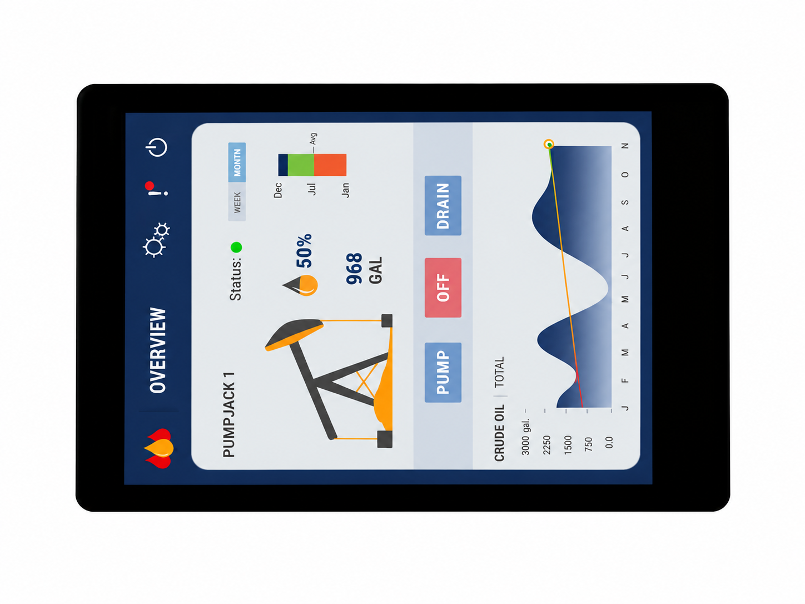 | 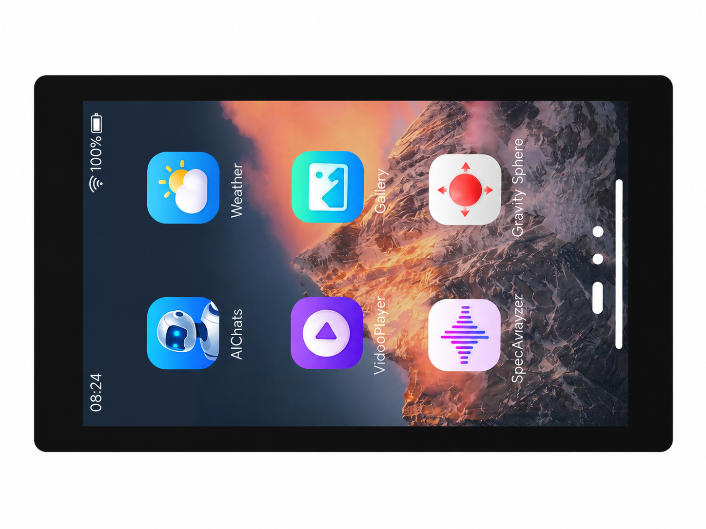 |
| 2.8-inch, ILI9341 + XPT2046 resistive touch | **V2 / CST3530 only** | **P4 chip revision v3.x, minimum v3.0** |

Product photos show factory demos; xTouch screenshots follow below. Other display, touch or chip revisions need separate adaptation. [CYD pins](docs/HARDWARE.en.md) · [S3/P4 hardware and builds](boards/README.md).

| Feature | CYD | S3 V2 | P4 4.3-inch |
|---|---|---|---|
| Landscape resolution | 320×240 | 320×240 | 800×480 |
| Flash / PSRAM | 4 MB / none | 16 MB / 8 MB | 32 MB / 32 MB |
| OTA application slots | 2 × 1.875 MiB | 2 × 6 MiB | 2 × 12 MiB |
| Data partition | 128 KiB | 3.875 MiB | 7.875 MiB |
| LAN / Cloud / Access Token | Supported | Supported | Supported |
| Account password / verification-code sign-in | Not compiled | Supported | Supported |
| Print, AMS, temperature and motion controls | Shared | Shared | Shared |
| Network standby / print wake | Supported | Supported | Supported |
| Optional idle deep sleep | Touch / reset wake | Touch / reset wake | Touch / reset wake |
| Touch and warning sounds / volume | Supported; off by default | Supported; off by default | Supported; off by default |
| Software LED control | RGB LED; on by default | Power/charge LEDs hardware-controlled | Power/charge LEDs hardware-controlled |
| Print image area | Printer artwork | Task thumbnail, up to 128 px | Task thumbnail, up to 512 px |
| JPEG camera | Unavailable | Supported; P1S compatible | Supported; P1S compatible |
| RTSPS / H.264 camera | Unavailable | Subject to codec/memory limits | Subject to codec/memory limits |
| Fault description module | Excluded | Optional; off by default | Optional; off by default |
| Fonts / icons | Small-screen assets | Small-screen assets | Large-screen assets |
| Xiaomi BLE thermometers | Excluded | Included | Included |

### 3D-printable cases

Download and extract the archive for your board, then choose the required variant. Each variant contains STL files for the case and three buttons.

| Board | Download | Included variants |
|---|---|---|
| Waveshare · ESP32-S3-Touch-LCD-2.8 V2 | [Case ZIP](cases/case_esp32-s3-touch-lcd-2.8-v2.zip) | `1mm`, `2mm` and `2mm+speaker`, each with `case_tf` and `case_tf_usb` cases. |
| Waveshare · ESP32-P4-WIFI6-Touch-LCD-4.3 | [Case ZIP](cases/case_esp32-p4-wifi6-touch-lcd-4.3.zip) | With or without a 40-pin opening; both options include a speaker variant. |

Choose the files matching your connector and speaker requirements. No CYD case is included.

## Interface gallery

Interface examples use demonstration data.

### S3 small screen · 320×240

| Home | Printing |
| --- | --- |
| 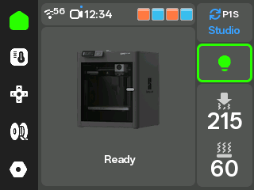 | 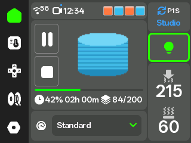 |

| Temperature and fans | Motion controls |
| --- | --- |
| 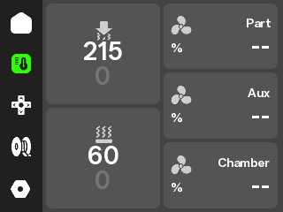 |  |

| Settings | Camera |
| --- | --- |
| 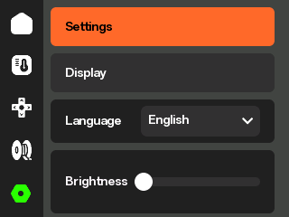 | 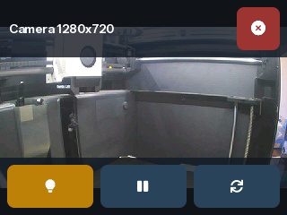 |

| Filament | Printer selection |
|---|---|
| 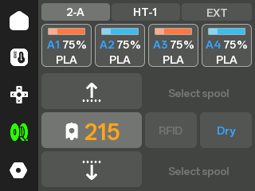 | 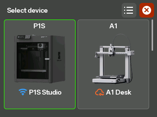 |

| Printer list | Control permissions |
|---|---|
| 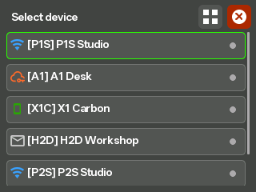 | 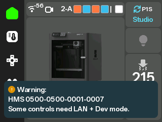 |

| Thermometer | Wi-Fi QR setup |
|---|---|
| 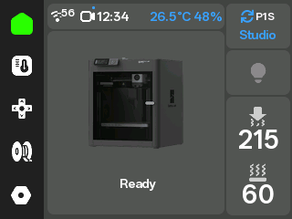 | 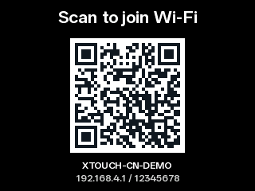 |

### P4 interface · 800×480

| Home | Printing |
|---|---|
| 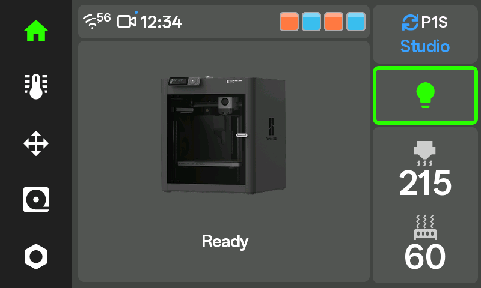 | 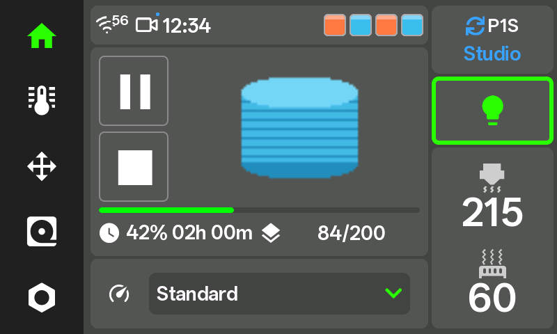 |

| Temperature and fans | Motion controls |
|---|---|
| 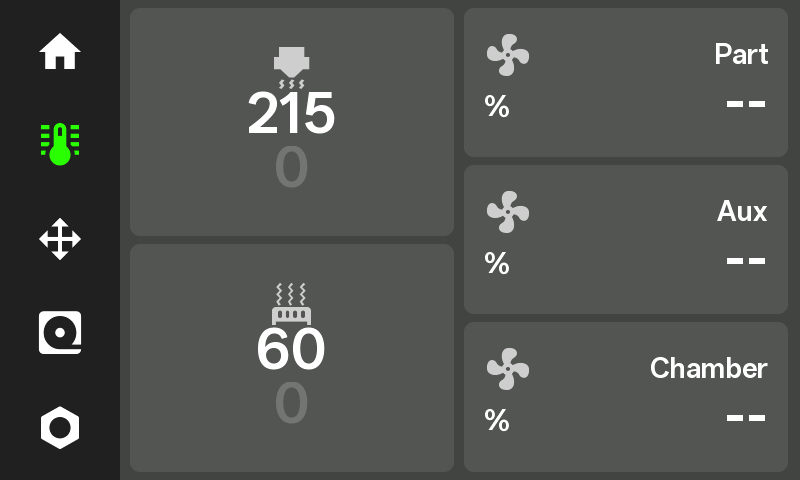 |  |

| Settings | Camera |
|---|---|
| 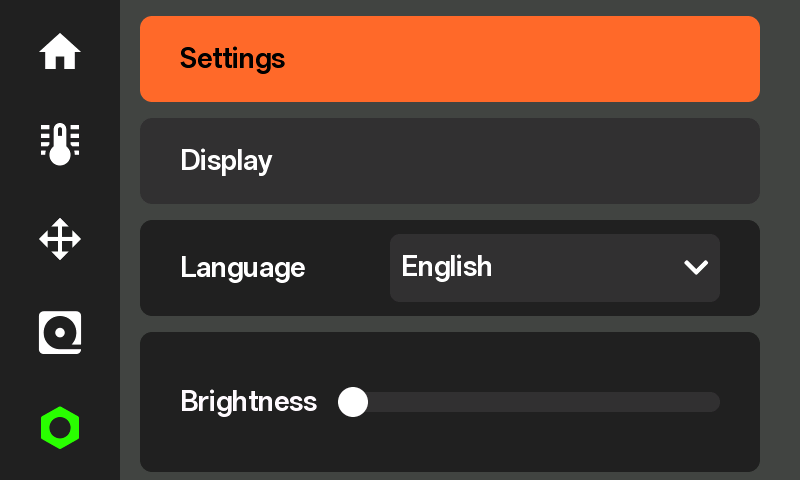 | 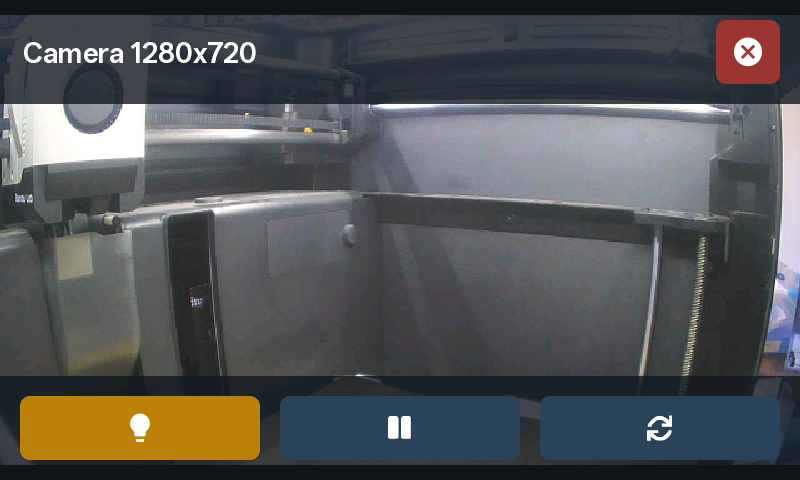 |

| Filament | Printer selection |
|---|---|
| 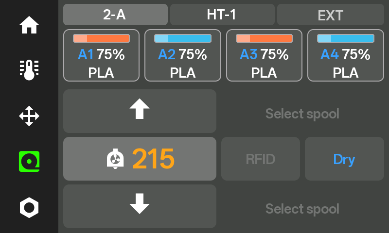 | 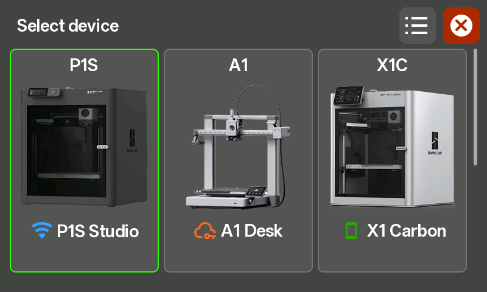 |

| Printer list | Control permissions |
|---|---|
| 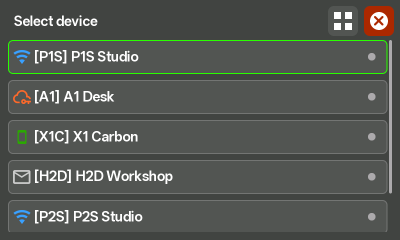 | 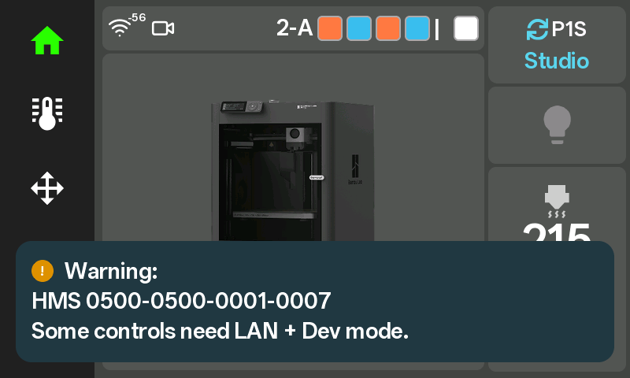 |

| Thermometer | Wi-Fi QR setup |
|---|---|
| 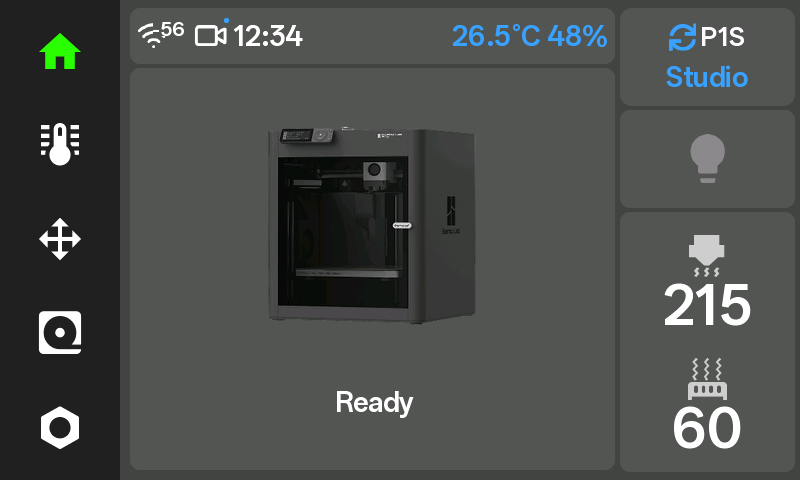 | 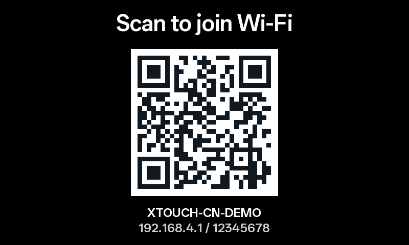 |

## Usage notes

- **Control permissions:** some controls require LAN mode and developer mode. Availability depends on printer firmware; a successful cloud or Token login does not authorize every command. See [Cloud control](docs/PRINTERS.en.md#authorization).
- **Camera and thumbnails:** S3/P4 support local JPEG viewing. RTSPS/H.264 depends on encoding and memory; see [Camera support](boards/CAMERA.md#en) for compatibility. LAN thumbnails use the task file and plate number, scanning at most the first 1 MiB without downloading the complete 3MF. Cloud thumbnails use the selected account and region, without borrowing LAN files. Unsupported layouts and unavailable thumbnails retain printer artwork; CYD always uses printer artwork.
- **Standby and sound:** ordinary screen standby stays online and supports print wake. Deep sleep disconnects and reconnects on wake. Deep sleep and sounds default to off; screen and portal settings provide sound switches and volume.
- **Printer switching:** tap the home printer card to cycle between up to two printers; with three or more, it opens the printer picker. Hold always opens the picker. Switching affects only the current connection; startup uses the saved default printer.
- **Text and faults:** subset fonts cover all interface languages; external filenames can contain missing glyphs. Default builds display fault codes; use the [online lookup](https://tbc0309.github.io/xTouch-CN/errors.html) for descriptions.

<details>
<summary>Optional: SD configuration and printer model codes</summary>

Use the [Configuration generator (alternative)](https://tbc0309.github.io/xTouch-CN/config.html?lang=en) to enter Wi-Fi, LAN printers, existing Access Tokens, and display and time settings. Import the downloaded JSON in the device portal, or extract the SD configuration package at the card root and restart. Tokens and printer connections still require verification in the device portal. Generated files contain plaintext credentials; keep them private.

`printerModel` uses case-sensitive protocol codes, such as `C12` for P1S; unknown models may be left empty. Artwork appears after valid model telemetry, otherwise the xTouch logo remains. These recognition mappings do not claim full hardware validation of every control.

| Model | `printerModel` protocol code |
| --- | --- |
| X1 Carbon | `BL-P001` |
| X1 | `BL-P002` |
| P1P | `C11` |
| P1S | `C12` |
| X1E | `C13` |
| A1 mini | `N1` |
| A1 | `N2S` |
| X2D | `N6` |
| P2S | `N7` |
| A2L | `N9` |
| H2C | `O1C` |
| H2C | `O1C2` |
| H2D | `O1D` |
| H2D Pro | `O1E` |
| H2S | `O1S` |

See [Storage](docs/MAINTENANCE.en.md#storage) for import and backup rules.

</details>

## Development and documentation

| Topic | Guides |
|---|---|
| Operation, AMS and faults | [Interaction](docs/USER-GUIDE.en.md#controls) · [AMS support](docs/PRINTERS.en.md#ams) · [Notifications](docs/USER-GUIDE.en.md#notifications) |
| Builds and board adaptation | [Development](docs/DEVELOPMENT.en.md) · [Architecture](docs/DEVELOPMENT.en.md#architecture) · [Build options](docs/DEVELOPMENT.en.md#options) |
| Firmware packaging and OTA | [Release packaging](docs/DEVELOPMENT.en.md#release) · [Updates](docs/INSTALLATION.en.md#install) |
| Compatibility and security | [MQTT scope](docs/PRINTERS.en.md#capabilities) · [Security](docs/MAINTENANCE.en.md#security) |

<details>
<summary>Source builds and per-board OTA manifests</summary>

CYD build:

```sh
npm ci --prefix web
python -m pip install platformio -r scripts/requirements.txt
python -m platformio run
```

The interface uses **OPPO Sans 4.0, weight 600**, with Noto Sans CJK fallback glyphs for Japanese kana and Korean. See [font copyright and licenses](LICENSE-3RD-PARTY.md#oppo-sans-40).

S3/P4 require the ESP-IDF environment. Follow the [board build guide](boards/README.md#构建) and run `python boards/build.py s3` or `python boards/build.py p4`. Generated fonts are included; ordinary builds do not require the original TTF.

| Board directory | OTA manifest |
|---|---|
| `esp32-2432s028r` | [ota.json](boards/esp32-2432s028r/ota.json) |
| `esp32-s3-touch-lcd-2.8-v2` | [ota.json](boards/esp32-s3-touch-lcd-2.8-v2/ota.json) |
| `esp32-p4-wifi6-touch-lcd-4.3` | [ota.json](boards/esp32-p4-wifi6-touch-lcd-4.3/ota.json) |

</details>

## Source and licensing

Upstream: [xperiments-in/xtouch](https://github.com/xperiments-in/xtouch). Upstream copyright notices are retained. Code follows the [upstream license](LICENSE.md); dependencies are listed in [Third-party licenses](LICENSE-3RD-PARTY.md).
