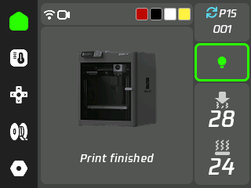
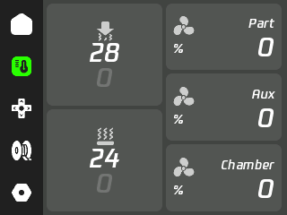
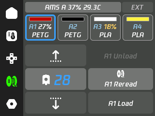
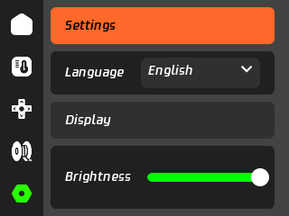
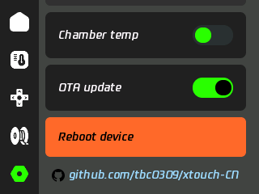
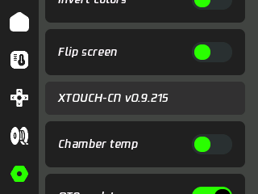
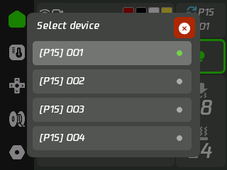

# xtouch-CN

[简体中文](README.md) | English

A multilingual version of [xTouch](https://github.com/xperiments-in/xtouch) for **2.8-inch, 240×320, ESP32** hardware, providing status monitoring and controls for Bambu Lab printers. Based on upstream `0.9.213`, it uses Tencent W7 for interface text and large numbers.

## Features

- Six languages: Simplified Chinese, Traditional Chinese, English, French, Russian and Japanese, with W7 interface text and large numbers.
- Printing status, temperature, fans, speed, light and motion controls.
- Up to 100 printer profiles, custom names and an on-screen device picker; one active connection at a time.
- Actual AMS filament colors, remaining-percentage alerts, source selection and confirmed load/unload/RFID operations.
- Internal settings and touch calibration, with SD synchronization and operation without SD after setup.
- SD and project OTA updates; tap the Settings version three times for a manual check.

Control availability depends on the printer and firmware. See [MQTT capabilities](docs/MQTT-CAPABILITIES.en.md). The font subset covers interface text; external job names may contain unsupported characters. HMS descriptions use the upstream English database.

## Supported CYD board


Supported board: **ESP32-2432S028R (2.8-inch CYD, resistive touch)**.

- ESP32 with 4MB Flash
- 240×320 display with an ILI9341 controller
- XPT2046 resistive touch and a microSD slot

Other display or touch variants require adaptation. [Specifications and pins](docs/HARDWARE.en.md).

## Device interface

Screenshots from the 2.8-inch device at its native landscape resolution of 320×240, shown in English. The interface language can be changed in Settings.

| Home | Temperature and fans |
| --- | --- |
|  |  |

| Motion controls | Filament |
| --- | --- |
|  |  |

| Settings and language | Project link |
| --- | --- |
|  |  |

| Device settings | Device picker |
| --- | --- |
|  |  |

## Download and installation

$\color{red}{\text{Original xTouch firmware supports upgrading to xtouch-CN via SD card.}}$

Download from [Releases](https://github.com/tbc0309/xtouch-CN/releases), then choose your installation path:

| Situation | Steps |
| --- | --- |
| Original xTouch installed | Rename `xtouch-2.8.bin` to `firmware.bin`, put it in the SD root and boot. Keep your configuration and calibration; remove old `xtouch/ota.json` first. |
| First USB installation | Flash `xtouch-2.8-full.bin` at `0x0`, then complete the setup below. |
| xtouch-CN already installed | Enable OTA and restart, or tap the Settings version three times. SD updates are also supported. |

Use the application image for SD updates, not `xtouch-2.8-full.bin`. Keep power connected during installation. See [Updates and recovery](docs/UPDATING.en.md) for detailed steps.

### First-time setup

1. Prepare a microSD card. Edit the [configuration example](examples/xtouch.multiple.json), keep only the printers you need, and save it as `/xtouch.json` in the SD root.
2. Set `ssid` and `pwd` to your Wi-Fi credentials. For each printer, enter `host`, `accessCode`, `serialNumber` and the model code listed below.
3. Insert the card, boot, complete touch calibration if prompted, and wait for Wi-Fi and printer connection. For printer-side setup, see the [upstream guide](README.upstream.md).
4. After import, configuration is stored internally and the card can be removed. Settings are saved internally and mirrored to SD when available. See [Storage and backup](docs/STORAGE.en.md).

Original single-printer configurations are imported automatically with `.bak` backups. Configuration files contain credentials; keep them private.

## Multiple printers

Fill in the [example configuration](examples/xtouch.multiple.json), save it as `/xtouch.json` in the SD root, and restart. Wi-Fi settings are shared; `printers` supports up to 100 entries.

- `name`: optional custom name, defaulting to `Printer 1`, etc. Long home-screen names scroll; picker rows use `[model] name`.
- `host`, `accessCode`, `serialNumber`, `printerModel`: per-printer connection settings. Access codes contain eight characters. Replace all example credentials.
- `activePrinter`: startup slot `0`–`99`, falling back to the first valid entry.
- `null` reserves an empty slot. Incomplete entries cannot be selected; configurations with more than 100 entries are rejected.
- Tap cycles through up to four configured printers; with more than four, tap opens the scrolling picker. Hold always opens it.
- One printer is connected at a time. Switching clears stale state and disconnects the previous connection. Offline targets retry with backoff.
- On-screen selection is temporary; startup still uses `activePrinter`. Legacy `mqtt` configuration is backed up as `.bak` and converted to the first slot.
- Custom names use the interface font subset; arbitrary external characters are not guaranteed.

### Printer model codes

Set `printerModel` to the protocol code below; for example, use `"printerModel": "C12"` for P1S. Codes are case-sensitive; do not use short names such as `P1S`.

| Model | `printerModel` protocol code |
| --- | --- |
| X1 Carbon | `BL-P001` |
| X1 | `BL-P002` |
| P1P | `C11` |
| P1S | `C12` |
| X1E | `C13` |
| A1 mini | `N1` |
| A1 | `N2S` |
| X2D | `N6` |
| P2S | `N7` |
| A2L | `N9` |
| H2C | `O1C` |
| H2C | `O1C2` |
| H2D | `O1D` |
| H2D Pro | `O1E` |
| H2S | `O1S` |

These are the firmware’s built-in model mappings, not a list of fully hardware-tested control implementations. `printerModel` is a configuration hint; home artwork appears only after a valid model is reported by the printer. Otherwise the xTouch logo remains visible. For an unknown model, use `"printerModel": ""`.

## Documentation

| Guide | Contents |
| --- | --- |
| [Hardware](docs/HARDWARE.en.md) | CYD specifications and GPIO pins |
| [Updates and recovery](docs/UPDATING.en.md) | Original firmware SD upgrade, USB installation and OTA |
| [Storage](docs/STORAGE.en.md) | Internal configuration, SD synchronization and backups |
| [MQTT capabilities](docs/MQTT-CAPABILITIES.en.md) | Filament controls and compatibility limits |
| [Printer artwork](docs/PRINTER-MODELS.en.md) | Model recognition, AMS display and image resources |
| [Development](docs/DEVELOPMENT.en.md) | Build, code structure, languages and fonts |

## Build from source

```sh
python -m pip install platformio
python -m platformio run
```

Generated fonts are included; a normal build needs neither Node.js nor the original TTF. See [Development](docs/DEVELOPMENT.en.md) for hardware configuration, font generation and release packaging.

## Source and licensing

Upstream project: [xperiments-in/xtouch](https://github.com/xperiments-in/xtouch). Upstream code, copyright notices, and history are retained. The code follows the [upstream license](LICENSE.md); see [third-party licenses](LICENSE-3RD-PARTY.md) for dependencies.

An independently maintained, unofficial localization.
