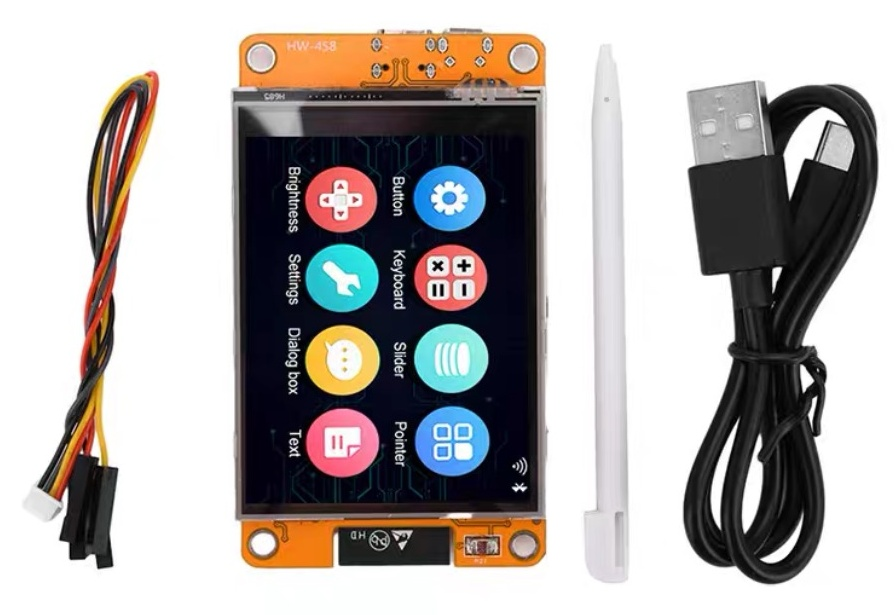
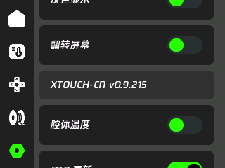
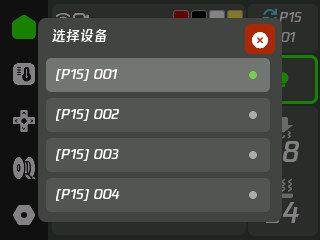

# xtouch-CN

简体中文 | [English](README.en.md)

[xTouch](https://github.com/xperiments-in/xtouch) 的多语言版本，面向 **2.8 英寸、240×320、ESP32** 机型，用于拓竹打印机状态显示与控制。基于上游 `0.9.213`，普通界面和大号数字均使用腾讯 W7 字体。

## 功能

- 六种语言：简体中文、繁体中文、英语、法语、俄语、日语，界面与大号数字使用 W7 字体。
- 打印状态、温度、风扇、速度、灯光和运动控制。
- 最多 100 台打印机配置，自定义名称与屏幕设备选择，一次连接一台。
- AMS 实际耗材色、剩余量提醒、耗材选择与进退料、RFID 重读确认。
- 配置和触摸校准保存在内部，SD 卡同步备份，初始化后可脱卡运行。
- SD 卡升级与本项目 OTA，连续点击设置页版本号三次可手动检查更新。

控制功能取决于打印机及固件，详见 [MQTT 支持范围](docs/MQTT-CAPABILITIES.md)。精简字库覆盖界面文案，外部打印文件名可能缺字；HMS 故障说明沿用上游英文数据库。

## 支持的 CYD 主板



适用主板：**ESP32-2432S028R（2.8 寸 CYD，电阻触摸版）**。

- ESP32，4MB Flash
- 240×320 屏幕，ILI9341 显示驱动
- XPT2046 电阻触摸，microSD 卡槽

其他屏幕或触摸版本不能直接通刷。[详细参数与引脚](docs/HARDWARE.md)。

## 实机界面

2.8 英寸实体机界面，横屏分辨率为 320×240。

| 首页 | 温度与风扇 |
| --- | --- |
|  |  |

| 运动控制 | 耗材 |
| --- | --- |
|  |  |

| 设置与语言 | 设置底部项目链接 |
| --- | --- |
|  |  |

| 设备设置 | 设备选择 |
| --- | --- |
|  |  |

## 下载与刷写

$\color{red}{\text{支持原版 xTouch 固件通过 SD 卡升级为本项目 xtouch-CN 固件。}}$

从 [Releases](https://github.com/tbc0309/xtouch-CN/releases) 下载，按当前情况选择：

| 当前情况 | 操作 |
| --- | --- |
| 已安装原版 xTouch | 将 `xtouch-2.8.bin` 改名为 `firmware.bin` 放到 SD 卡根目录，插卡开机升级。保留配置与校准，先移除旧的 `xtouch/ota.json`。 |
| 首次 USB 安装 | 将 `xtouch-2.8-full.bin` 写入 `0x0`，再按下面步骤初始化。 |
| 已安装 xtouch-CN | 开启 OTA 后重启，或连续点击设置页版本号三次检查更新；也可使用 SD 卡升级。 |

SD 卡升级使用应用固件，不要使用 `xtouch-2.8-full.bin`。安装时保持供电。详细步骤见 [更新与维护](docs/UPDATING.md)。

### 首次配置

1. 准备 microSD 卡，填写 [配置示例](examples/xtouch.multiple.json)，只保留需要的打印机，保存到卡根目录 `/xtouch.json`。
2. `ssid`、`pwd` 填 Wi-Fi 名称与密码；各打印机填写 `host` 地址、`accessCode` 访问码、`serialNumber` 序列号和下方机型代码。
3. 插卡开机，按提示完成触摸校准，等待连接 Wi-Fi 和打印机。打印机端设置可参考 [上游说明](README.upstream.md)。
4. 导入完成后配置保存在内部，可拔卡运行。日常设置先保存到内部，有卡时同步备份，详见 [存储与备份](docs/STORAGE.md)。

原版单设备配置会自动导入并保留 `.bak` 备份。配置含密码和访问码，请勿公开分享。

## 多设备配置

将 [多设备示例](examples/xtouch.multiple.json) 填好后，保存到 SD 卡根目录 `/xtouch.json`，重启加载。Wi-Fi 配置所有设备共用，`printers` 最多 100 个条目。

- `name`：自定义名称，未填显示 `Printer 1` 等默认名称。首页显示名称，过长时滚动；设备列表显示 `[机型] 名称`。
- `host`、`accessCode`、`serialNumber`、`printerModel`：各打印机的连接参数。访问码必须为 8 个字符，示例参数需替换为自己的值。
- `activePrinter`：开机默认槽位，`0`～`99`。无效时选择第一个有效条目。
- `null` 可保留空槽位；不完整条目不可选择。超过 100 个条目的配置不导入。
- 4 台以内短按设备卡顺序切换；超过 4 台短按打开可上下滑动的设备列表。长按始终打开列表。
- 一次只连接一台；切换前断开旧连接并清空状态，离线设备退避重试，可继续选择其他设备。
- 屏幕切换不写 SD、不保存当前选择；下次启动仍使用 `activePrinter`。原单设备 `mqtt` 配置备份为 `.bak`，自动转换到第一个槽位。
- 自定义名称受精简字库限制，推荐英文/数字；任意外部字符不保证覆盖。

各打印机需开启局域网连接，并填写对应的地址、访问码和序列号。

### 机型协议代码

`printerModel` 填写下表中的协议代码，例如 P1S 填 `"printerModel": "C12"`。代码区分大小写，不要直接填写 `P1S` 等简称。

| 机型 | `printerModel` 协议代码 |
| --- | --- |
| X1 Carbon | `BL-P001` |
| X1 | `BL-P002` |
| P1P | `C11` |
| P1S | `C12` |
| X1E | `C13` |
| A1 mini | `N1` |
| A1 | `N2S` |
| X2D | `N6` |
| P2S | `N7` |
| A2L | `N9` |
| H2C | `O1C` |
| H2C | `O1C2` |
| H2D | `O1D` |
| H2D Pro | `O1E` |
| H2S | `O1S` |

以上为当前固件内置的机型映射，不代表所有机型的控制功能都已实机验证。`printerModel` 是配置提示；首页收到打印机报告的有效型号后才显示对应图片，否则保留 xTouch 标志。未知型号可留空 `"printerModel": ""`。

## 文档

| 文档 | 内容 |
| --- | --- |
| [硬件说明](docs/HARDWARE.md) | CYD 参数与 GPIO 引脚 |
| [更新与维护](docs/UPDATING.md) | 原版卡刷、USB 安装、OTA 与恢复 |
| [存储与备份](docs/STORAGE.md) | 内部配置、SD 同步与备份规则 |
| [MQTT 支持范围](docs/MQTT-CAPABILITIES.md) | 耗材操作与控制兼容范围 |
| [机型显示](docs/PRINTER-MODELS.md) | 机型识别、AMS 显示与图片资源 |
| [开发说明](docs/DEVELOPMENT.md) | 编译、代码结构、语言与字体 |

## 源码编译

```sh
python -m pip install platformio
python -m platformio run
```

仓库已包含生成字库，普通编译不需要 Node.js 或原始 TTF。硬件配置、字库生成与发布打包见 [开发说明](docs/DEVELOPMENT.md)。

## 来源与许可

原项目：[xperiments-in/xtouch](https://github.com/xperiments-in/xtouch)。保留上游代码、版权及历史，代码沿用 [上游许可证](LICENSE.md)，第三方组件见 [许可说明](LICENSE-3RD-PARTY.md)。

个人汉化修改，非官方维护版本。
