# xTouch-CN

简体中文 | [English](README.en.md)

用于拓竹打印机状态显示与控制的多语言触摸屏固件，支持 ESP32-2432S028R、Waveshare S3 V2 和 P4 主板。基于 [xTouch](https://github.com/xperiments-in/xtouch) `0.9.213`，独立维护，非官方版本。

**[在线刷写](https://tbc0309.github.io/xTouch-CN/)** · [固件下载](https://github.com/tbc0309/xTouch-CN/releases/latest) · [故障码查询](https://tbc0309.github.io/xTouch-CN/errors.html) · [全部文档](docs/README.md)

[安装与配置](#安装与配置) · [主板对比](#主板功能对比) · [界面展示](#界面展示) · [使用说明](#使用说明) · [开发与文档](#开发与文档)

## 主要功能

- 八种语言：简体中文、繁體中文、英语、法语、德语、俄语、日语、韩语。
- 支持局域网和拓竹账号 Access Token；S3/P4 另提供账号登录，扫码配网、网页管理；最多保存 100 台打印机，一次连接一台。
- 查看打印进度、温度、AMS 耗材颜色与余量；控制灯光、风扇、速度、运动及进退料。
- S3/P4 支持摄像头和打印缩略图；三板均支持提示音、联网待机、打印唤醒与可选深睡。
- 首页在 NTP 同步后显示当地时间，AMS 占满状态栏时自动隐藏；首次访问后台可自动保存浏览器时区，配置可自定义。
- S3/P4 支持 Xiaomi BLE 温湿度计，可与 AMS 交替显示或仅显示温湿度；在后台绑定 MAC 和 BLE Key，交替间隔为 1～30 秒，默认 5 秒。
- 配置保存在设备内部，可使用 SD 卡同步备份；支持网页后台、SD 卡及 OTA 升级。

温湿度计支持 **19 个型号标识、23 个产品 ID**，型号、产品名称及实测范围见[温湿度计支持列表](docs/THERMOMETERS.md)。

## 安装与配置

先核对下方完整主板型号。**三板固件不能混刷；应用镜像用于升级，`-full.bin` 用于 USB 安装。**

| 当前情况 | 操作 |
|---|---|
| 首次安装 | 打开 [在线刷写](https://tbc0309.github.io/xTouch-CN/)，选择对应主板和串口，按提示安装。 |
| 已安装 xTouch-CN | 在网页后台上传对应主板的应用镜像，或在设置页连续点击版本号三次检查 OTA。也可开启开机检查更新或使用 SD 卡升级。 |

固件文件与恢复步骤见 [更新与维护](docs/INSTALLATION.md#install)。

### 首次配置

1. CYD 按提示完成触摸校准；S3 V2/P4 无需校准。扫描屏幕二维码连接设备热点，密码 `12345678`。
2. 打开 `http://192.168.4.1/`，设置家庭 2.4 GHz Wi-Fi。
3. 在屏幕设置中打开“网页管理”并扫码，使用初始管理密码 `12345678` 登录后修改密码。
4. 添加局域网打印机后点击“验证并保存设备”，或验证拓竹账号 Access Token 后勾选关联设备。修改连接参数后需重新验证；其他有效设置自动保存。

日常运行无需 SD 卡，可在网页后台导入、导出配置备份。详见 [网页管理](docs/INSTALLATION.md#accounts)、[Token 获取](docs/INSTALLATION.md#token) 和 [存储与备份](docs/MAINTENANCE.md#storage)。

## 主板功能对比

| CYD · ESP32-2432S028R | 微雪 · ESP32-S3-Touch-LCD-2.8 V2 | 微雪 · ESP32-P4-WIFI6-Touch-LCD-4.3 |
|---|---|---|
|  |  |  |
| 2.8 英寸，ILI9341 + XPT2046 电阻触摸 | 仅 **V2 / CST3530** | **P4 芯片版本 v3.x，最低 v3.0** |

商品图片展示原厂演示界面，xTouch 界面见下方。其他屏幕、触摸或芯片版本需单独适配；[CYD 引脚](docs/HARDWARE.md) · [S3/P4 硬件与构建](boards/README.md)。

| 功能 | CYD | S3 V2 | P4 4.3 英寸 |
|---|---|---|---|
| 横屏分辨率 | 320×240 | 320×240 | 800×480 |
| Flash / PSRAM | 4 MB / 无 | 16 MB / 8 MB | 32 MB / 32 MB |
| OTA 应用槽 | 2 × 1.875 MiB | 2 × 6 MiB | 2 × 12 MiB |
| 数据分区 | 128 KiB | 3.875 MiB | 7.875 MiB |
| LAN / Cloud / Access Token | 支持 | 支持 | 支持 |
| 账号密码 / 验证码登录 | 不编译 | 支持 | 支持 |
| 打印、AMS、温度与运动控制 | 共用 | 共用 | 共用 |
| 联网待机、打印唤醒 | 支持 | 支持 | 支持 |
| 可选空闲深睡 | 触摸或复位唤醒 | 触摸或复位唤醒 | 触摸或复位唤醒 |
| 触摸音、警告音 | 支持，默认关闭 | 支持，默认关闭 | 支持，默认关闭 |
| 软件指示灯 | RGB 可控，默认开启 | 电源/充电灯由硬件控制 | 电源/充电灯由硬件控制 |
| 打印时图片区域 | 机型图 | 任务缩略图，最大128像素 | 任务缩略图，最大512像素 |
| JPEG 摄像头 | 不支持 | 支持，P1S 兼容 | 支持，P1S 兼容 |
| RTSPS/H.264 摄像头 | 不支持 | 受编码和内存限制 | 受编码和内存限制 |
| 故障码文字详情 | 不编译 | 可选模块，默认关闭 | 可选模块，默认关闭 |
| 字体、图标 | 小屏资源 | 小屏资源 | 大屏资源 |
| Xiaomi BLE 温湿度计 | 不包含 | 包含 | 包含 |

### 3D 打印外壳

按主板型号下载并解压，选择所需版本打印。各版本目录均包含外壳与三个按键的 STL 文件。

| 主板 | 下载 | 包内版本 |
|---|---|---|
| 微雪 · ESP32-S3-Touch-LCD-2.8 V2 | [外壳 ZIP](cases/case_esp32-s3-touch-lcd-2.8-v2.zip) | `1mm`、`2mm`、`2mm+speaker`；各含 `case_tf` 与 `case_tf_usb` 外壳。 |
| 微雪 · ESP32-P4-WIFI6-Touch-LCD-4.3 | [外壳 ZIP](cases/case_esp32-p4-wifi6-touch-lcd-4.3.zip) | 无 40-pin 开口、带 40-pin 开口，两种均提供带扬声器版本。 |

请根据接口与扬声器需求选择文件；不包含 CYD 外壳。

## 界面展示

以下为界面示例，数据为演示数据。

### S3 小屏 · 320×240

| 首页 | 打印状态 |
|---|---|
| 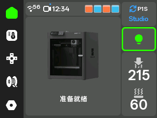 |  |

| 温度与风扇 | 运动控制 |
|---|---|
| 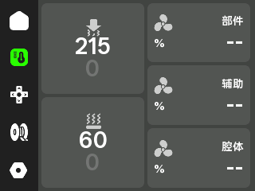 | 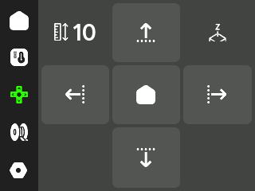 |

| 设置 | 摄像头 |
|---|---|
| 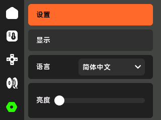 | 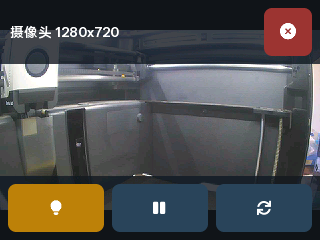 |

| 耗材 | 选择打印机 |
|---|---|
| 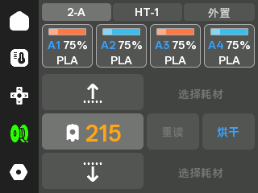 | 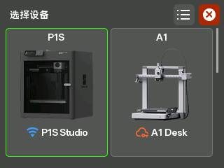 |

| 设备列表 | 控制权限提醒 |
|---|---|
| 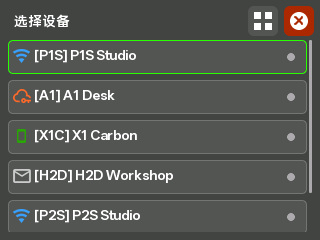 | 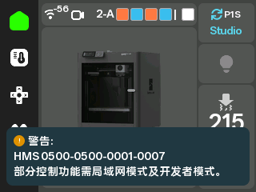 |

| 温湿度计 | Wi-Fi 扫码配网 |
|---|---|
|  | 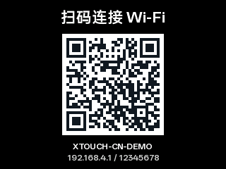 |

### P4 界面 · 800×480

| 首页 | 打印状态 |
|---|---|
| 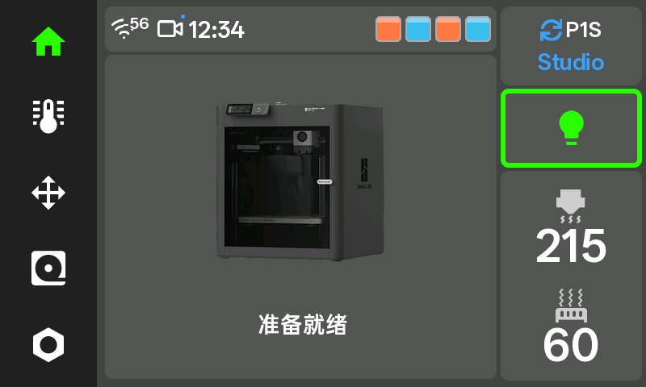 | 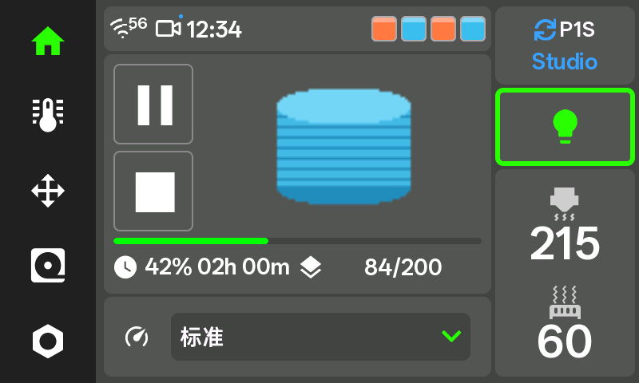 |

| 温度与风扇 | 运动控制 |
|---|---|
| 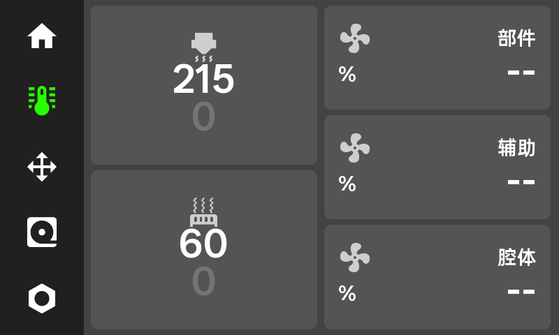 | 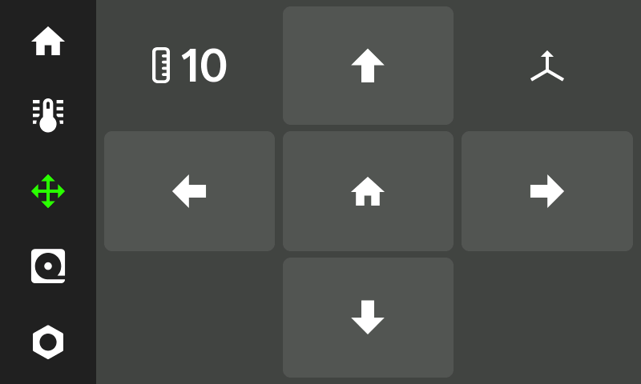 |

| 设置 | 摄像头 |
|---|---|
| 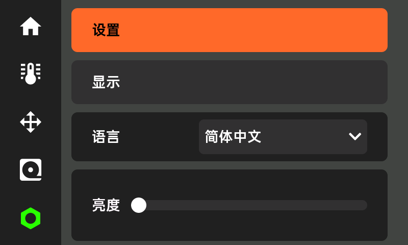 | 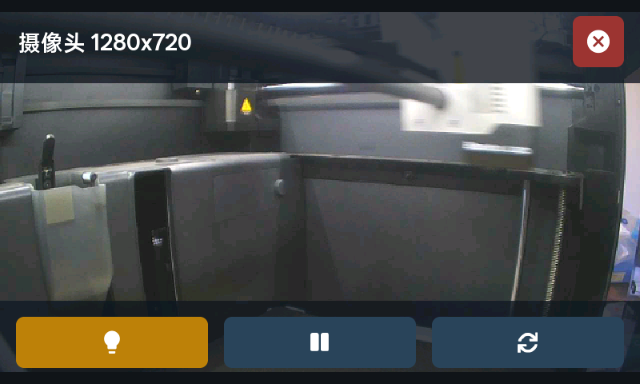 |

| 耗材 | 选择打印机 |
|---|---|
| 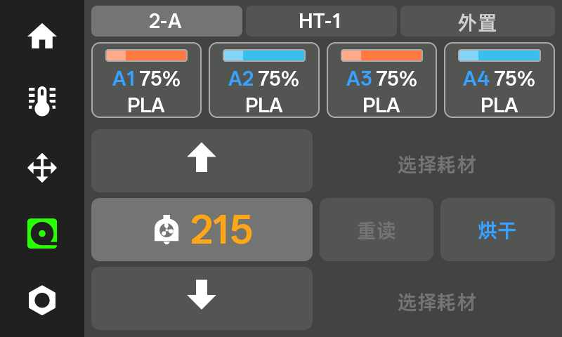 | 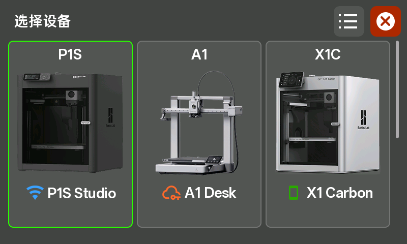 |

| 设备列表 | 控制权限提醒 |
|---|---|
| 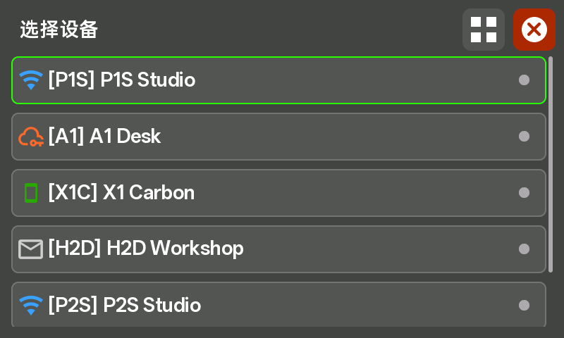 | 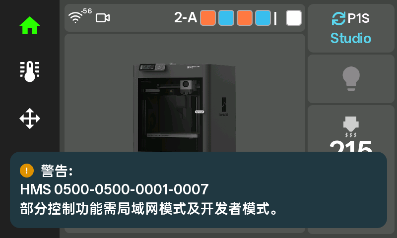 |

| 温湿度计 | Wi-Fi 扫码配网 |
|---|---|
| 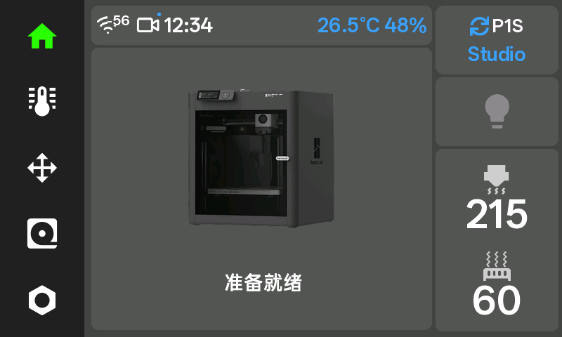 |  |

## 使用说明

- **控制权限**：部分控制功能需局域网模式及开发者模式。实际能力取决于打印机及固件；拓竹账号或 Token 登录成功不代表所有命令获准，见 [云端控制](docs/PRINTERS.md#authorization)。
- **摄像头与缩略图**：S3/P4 支持本地 JPEG 摄像头；RTSPS/H.264 受编码和内存限制，机型兼容情况见[摄像头说明](boards/CAMERA.md)。局域网缩略图按任务文件与盘号读取，最多扫描文件前 1 MiB，不下载整个 3MF；云端按所选账号及区域读取当前任务图片，两种连接不混用。遇到不支持的文件布局或缩略图未就绪时显示机型图。CYD 始终使用机型图。
- **待机与声音**：普通休眠保持联网，可收到打印唤醒。深睡断网，唤醒时重新连接；深睡与提示音默认关闭，声音开关、音量可在屏幕或后台设置。
- **多设备切换**：两台以内点按首页设备卡依次切换；三台及以上时打开设备选择页，长按始终打开设备选择页。切换只影响当前连接，开机仍使用保存的默认设备。
- **文字与故障**：精简字库覆盖八语界面，外部文件名可能缺字。默认显示原始故障码，含义可在 [在线查询页](https://tbc0309.github.io/xTouch-CN/errors.html) 查看。

<details>
<summary>可选：SD 配置与机型协议代码</summary>

使用[配置文件生成器（备用）](https://tbc0309.github.io/xTouch-CN/config.html?lang=zh)填写 Wi-Fi、局域网设备、已有 Access Token 和显示与时间设置。下载的 JSON 可从设备后台导入；使用 TF 卡时，将配置包解压到卡根目录后重启。Token 和设备连接仍需在设备后台验证。生成文件包含明文凭据，请妥善保管。

`printerModel` 使用区分大小写的协议代码，例如 P1S 填 `C12`；未知型号可留空。收到有效型号上报后显示机型图片，否则保留 xTouch 标志。下表是识别映射，不代表全部控制已完成实机验证。

| 机型 | `printerModel` 协议代码 |
| --- | --- |
| X1 Carbon | `BL-P001` |
| X1 | `BL-P002` |
| P1P | `C11` |
| P1S | `C12` |
| X1E | `C13` |
| A1 mini | `N1` |
| A1 | `N2S` |
| X2D | `N6` |
| P2S | `N7` |
| A2L | `N9` |
| H2C | `O1C` |
| H2C | `O1C2` |
| H2D | `O1D` |
| H2D Pro | `O1E` |
| H2S | `O1S` |

配置导入与备份规则见 [存储说明](docs/MAINTENANCE.md#storage)。

</details>

## 开发与文档

| 内容 | 入口 |
|---|---|
| 操作、AMS 与故障提示 | [交互规则](docs/USER-GUIDE.md#controls) · [AMS 支持](docs/PRINTERS.md#ams) · [提示规则](docs/USER-GUIDE.md#notifications) |
| 编译与新主板适配 | [开发说明](docs/DEVELOPMENT.md) · [代码结构](docs/DEVELOPMENT.md#architecture) · [功能模块](docs/DEVELOPMENT.md#options) |
| 固件打包与 OTA | [发布构建](docs/DEVELOPMENT.md#release) · [更新与恢复](docs/INSTALLATION.md#install) |
| 兼容与安全 | [MQTT 范围](docs/PRINTERS.md#capabilities) · [安全说明](docs/MAINTENANCE.md#security) |

<details>
<summary>源码构建与各主板 OTA 清单</summary>

CYD 构建：

```sh
npm ci --prefix web
python -m pip install platformio -r scripts/requirements.txt
python -m platformio run
```

界面文字使用 **OPPO Sans 4.0，字重 600**；日文假名和韩文缺字使用 Noto Sans CJK 补齐。详见[字体版权与许可](LICENSE-3RD-PARTY.md#oppo-sans-40)。

S3/P4 使用 ESP-IDF 工具环境，按 [主板开发说明](boards/README.md#构建) 执行 `python boards/build.py s3` 或 `python boards/build.py p4`。生成字体已包含在仓库，普通构建无需原始 TTF。

| 主板目录 | OTA 清单 |
|---|---|
| `esp32-2432s028r` | [ota.json](boards/esp32-2432s028r/ota.json) |
| `esp32-s3-touch-lcd-2.8-v2` | [ota.json](boards/esp32-s3-touch-lcd-2.8-v2/ota.json) |
| `esp32-p4-wifi6-touch-lcd-4.3` | [ota.json](boards/esp32-p4-wifi6-touch-lcd-4.3/ota.json) |

</details>

## 来源与许可

原项目：[xperiments-in/xtouch](https://github.com/xperiments-in/xtouch)。保留上游版权，代码沿用 [上游许可证](LICENSE.md)，第三方组件见 [许可说明](LICENSE-3RD-PARTY.md)。
