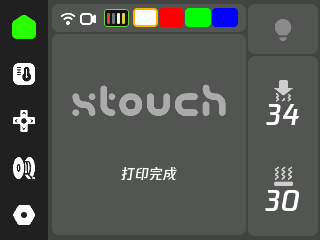
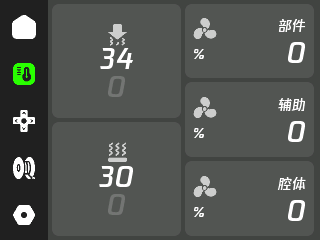
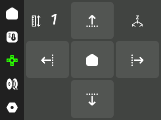
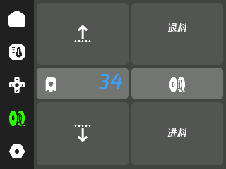
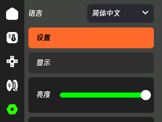
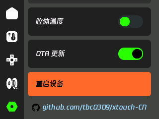

# xtouch-CN

简体中文 | [English](README.en.md)

[xTouch](https://github.com/xperiments-in/xtouch) 的多语言版本，面向 **2.8 英寸、240×320、ESP32** 机型，用于拓竹打印机状态显示与控制。基于上游 `0.9.213`，普通界面和大号数字均使用腾讯 W7 字体。

## 功能

- 简体中文、繁體中文、English，设置页切换，立即生效并记忆。
- 最多四台打印机配置，顶部白、红、绿、蓝色块点击切换。
- 独立 AMS 图标；切换时在状态区域显示设备名称 2 秒。
- 配置与触摸校准保存在内部，初始化后可脱离 SD 卡，插卡自动同步备份。
- 项目 OTA 更新，有卡暂存、无卡直接更新备用程序分区，保留内部配置。
- 速度选择：静音、标准、运动、狂暴。
- LVGL 全局默认中文字体，覆盖下拉列表等动态控件；保留原有图标字体。
- 中文文案独立存放，按实际使用字符生成 14px 和 28px 灰阶字库。

HMS 故障说明使用上游英文数据库。精简字库覆盖内置界面文案，打印任务名等外部中文可能存在缺字。

## 下载与刷写

从 [Releases](https://github.com/tbc0309/xtouch-CN/releases) 下载：

| 文件 | 用途 |
| --- | --- |
| `xtouch-2.8-full.bin` | USB 首次安装的完整镜像，写入地址 `0x0` |
| `xtouch-2.8.bin` | 应用固件，用于 OTA；SD 更新时命名为 `firmware.bin`，单独 USB 写入须确认当前启动分区 |

首次初始化需要 SD 卡和打印机连接配置；导入内部存储后可脱离 SD 卡运行，触摸校准、语言等设置保存在机器内。详见 [内部配置与 SD 同步](docs/STORAGE.md)。配网、打印机配置及触摸校准按 [上游使用说明](README.upstream.md) 操作。仅面向上游所支持的 2.8 英寸硬件；其他屏幕驱动或引脚不同的板子需要单独适配。

```sh
python -m esptool --chip esp32 --port COM5 --baud 115200 write_flash 0x0 xtouch-2.8-full.bin
```

将 `COM5` 替换为自己的串口。设置页开启 OTA 后，下次开机检查本项目发布的新版本。详见 [更新与维护](docs/UPDATING.md)。

## 实机界面

2.8 英寸实体机界面，横屏分辨率为 320×240。

| 首页 | 温度与风扇 |
| --- | --- |
|  |  |

| 运动控制 | 耗材 |
| --- | --- |
|  |  |

| 设置与语言 | 设置底部项目链接 |
| --- | --- |
|  |  |

## 多设备配置

将 [多设备示例](examples/xtouch.multiple.json) 填好后，保存到 SD 卡根目录 `/xtouch.json`，重启加载。Wi-Fi 配置所有设备共用，`printers` 最多四个条目，固定对应顶部白、红、绿、蓝四个色块。

- `name`：自定义名称，未填显示 `Printer 1` 等默认名称；切换设备时在状态位置显示名称 2 秒，平时不常驻显示。
- `host`、`accessCode`、`serialNumber`、`printerModel`：各打印机的连接参数。访问码必须为 8 个字符；示例地址与序列号必须换为自己的值。
- `activePrinter`：开机默认槽位，`0`～`3`。无效时选择第一个有效条目。
- 未添加、`null` 或参数不完整的条目显示灰色、不能点击。用 `null` 可以保留空槽位；第五台及以后忽略。
- 有效条目显示固定槽位颜色，当前设备增加金色边框；点击其他色块切换，状态区域显示“正在切换到 xxx”。
- 一次只连接一台打印机，切换前断开旧连接并清空状态、温度、任务和故障提示。离线设备自动退避重试，可继续选择其他设备。
- 点击切换不写 SD、不保存选择；下次启动仍使用 `activePrinter`。原单设备 `mqtt` 配置会备份为 `.bak`，自动转换到第一个槽位。
- 自定义中文名称受精简字库限制，推荐英文/数字；如需特定中文字，须生成包含对应字符的字库。

各打印机需开启局域网连接，并填写对应的地址、访问码和序列号。

## 源码编译

安装 Python、PlatformIO 后，在仓库目录运行：

```sh
python -m pip install platformio
python -m platformio run
```

构建环境为 `esp32dev`，已包含生成后的字库，普通编译不需要原始 TTF，也不需要 Node.js。应用输出到 `.pio/build/esp32dev/firmware.bin`，打包产物分别位于相邻的 `xtouch-bin/ota/` 和 `xtouch-bin/webusb/`，构建不会自动改变 `version.json`。开发结构见 [开发说明](docs/DEVELOPMENT.md)。

## 汉化与字体维护

设置页顶部可选择简体中文、繁體中文或 English，立即切换并保存到内部 `/xtouch/settings.json`，有 SD 卡时同步备份，重启后保留。语言文案分别位于 `src/ui/i18n/zh_cn.h`、`zh_tw.h` 和 `en.h`，统一使用全局 W7 字体。

- 三种语言文案与选择入口：`src/ui/i18n/`；新增文案须补齐三种语言。
- 全局字体：`resources/lv_conf.h` 中的 `LV_FONT_DEFAULT` 和 `XTOUCH_FONT_NUMERIC`。
- 字库生成：`scripts/localize_zh.py`，只生成字体，不改写应用源码。
- 覆盖检查：`python scripts/check_localization.py`。

更换文案或字体时安装 Node.js，提供自己有权使用的腾讯 W7 TTF，再生成子集：

```powershell
$env:XTOUCH_W7_FONT='C:\fonts\Tencent-W7.ttf'
python scripts/localize_zh.py
python scripts/check_localization.py
python -m platformio run
```

原始 TTF 不随仓库分发。字体相关权利归原权利人所有，使用和再分发需自行确认对应授权。默认使用仓库内的厂商错误数据库；如需重新抓取，安装 Node.js 并设置 `XTOUCH_REFRESH_ERRORS=1` 后编译。

## 来源与许可

原项目：[xperiments-in/xtouch](https://github.com/xperiments-in/xtouch)。保留上游代码、版权及历史，代码沿用 [上游许可证](LICENSE.md)，第三方组件见 [许可说明](LICENSE-3RD-PARTY.md)。

个人汉化修改，非官方维护版本。
