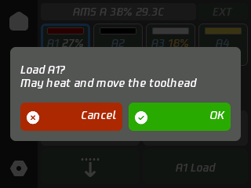
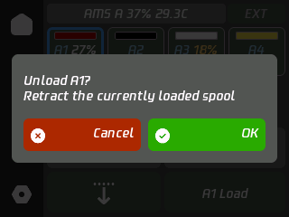
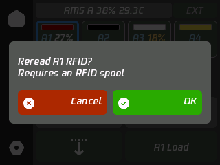

# MQTT capabilities and controls

[简体中文](MQTT-CAPABILITIES.md) | English | [README](../README.en.md)

Available fields and commands depend on the printer and its firmware. Model artwork does not imply full control compatibility.

## Current support

| Data | Handling |
| --- | --- |
| Print state and progress | Displays reported state and progress |
| Nozzle and bed | Actual and target temperatures, with temperature adjustment |
| Fans | Traditional fan display/control; speed levels are not RPM |
| AMS | Material, actual color, valid remaining percentage, humidity and temperature |
| External spool | Separate source selection and color |
| Chamber | Legacy/packed telemetry; target control requires a supported heater and valid telemetry |
| Model | Reported model recognition and matching artwork |

Humidity levels are not percentages. Missing/invalid readings must not be displayed as zero. See [Printer artwork and telemetry](PRINTER-MODELS.en.md) for recognition and display details.

## Not yet fully supported

Version 1.0.0 supports Pro/HT drying, HT/Lite Mixed routing, numeric T0/T1 temperature entry, nozzle selection and indexed extrusion, dual external sources, basic H2C rack management and chamber targets. See the [illustrated review](NEW-MODELS-AMS.md). New bed controls, automatic hotend exchange, shared-route rebinding and advanced drying settings remain unavailable; hardware actions need physical validation. Reported `remain_g` must not be inferred from a fixed 1kg spool. Existing single-extruder commands are not a universal control path for new models.

## Protocol references

BambuStudio parsers: [AMS](https://github.com/bambulab/BambuStudio/blob/master/src/slic3r/GUI/DeviceCore/DevFilaSystem.cpp), [extruders](https://github.com/bambulab/BambuStudio/blob/master/src/slic3r/GUI/DeviceCore/DevExtruderSystem.cpp), [bed](https://github.com/bambulab/BambuStudio/blob/master/src/slic3r/GUI/DeviceCore/DevBed.cpp), [fans](https://github.com/bambulab/BambuStudio/blob/master/src/slic3r/GUI/DeviceCore/DevFan.cpp), [chamber](https://github.com/bambulab/BambuStudio/blob/master/src/slic3r/GUI/DeviceCore/DevChamber.cpp).

## Filament controls

**EXT** stays fixed on the right. The independent AMS lane displays up to four units; additional units scroll horizontally. Dragging does not select a source. The bounded cache maps four four-slot units, eight HT units and one Lite Mixed group. Only reported slots are displayed; physical IDs are translated separately. Unknown types and ambiguous extruder bindings block control.

Select an AMS slot or **EXT** first. A blue outline is the UI target; a green outline remains the printer's loaded feeder. Selection alone does not change filament. Tap a selected slot again to clear it. Switching printers clears the selection.

Load, Unload and Reread are disabled without a selection and show the selected source when available. Load requests the printer's filament-change procedure, which may unload the previous source, heat and move the toolhead. Unload is enabled only for the source actually loaded. Reread requests AMS RFID identification when unloaded; it cannot identify an untagged spool. Load temperatures come from the reported nozzle temperature range, or an explicitly configured nozzle target. Without either, the button asks the user to set the temperature first. Removing a spool or AMS clears its cached temperatures. Legacy external loading uses protocol source 254. New dual external inputs map T0/T1 to protocol IDs 255/254. External loading may require manual feeding when prompted; RFID is unavailable for EXT.

The left arrows are independent of the selected AMS slot. Legacy single-nozzle devices retract/extrude 10mm; new-protocol devices open indexed nozzle controls for explicit selection and confirmation. The center-left card also opens these controls. Each source operation requires confirmation and checks device identity, slot presence, connection and printer/AMS state again before publishing. Printing, paused, preparing, busy AMS and RFID-reading states block these operations. Unadapted models and multi-extruder routing do not use the legacy single-extruder command path.

Commands follow [Bambu Studio DeviceManager.cpp](https://github.com/bambulab/BambuStudio/blob/master/src/slic3r/GUI/DeviceManager.cpp): `command_ams_change_filament` and `command_ams_refresh_rfid2`. Printer firmware behavior requires hardware-specific validation. Error `84033543` indicates unsigned control was rejected: check LAN Only and Developer Mode on the printer screen, accounting for the effect on cloud connectivity. Replies are matched to this device's request sequence before displaying a rejection; another client's reply or command receipt alone is not treated as execution success.

## Filament confirmations

| Load | Unload | Reread RFID |
| --- | --- | --- |
|  |  |  |

## Cloud control validation limit

Account and Token profiles use the same cloud command path. Reread is not disabled solely because the profile uses Cloud. A real P1S test published `ams_get_rfid` successfully but received `84033543`; cloud RFID control is therefore not validated as working. Official clients also pass commands through their networking agent. See [Cloud command authorization](CLOUD-CONTROL.md).
