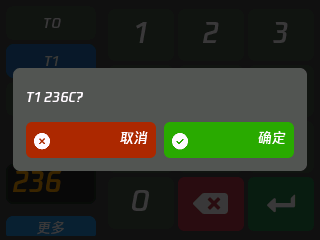
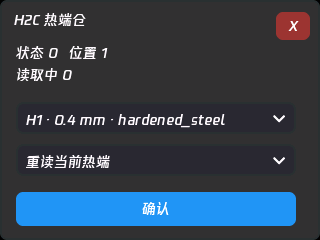
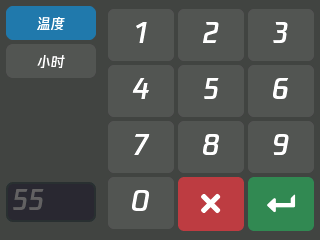
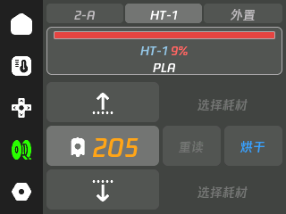
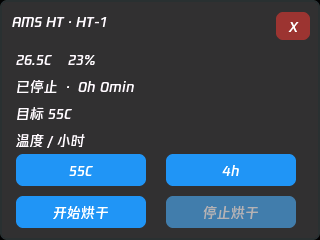
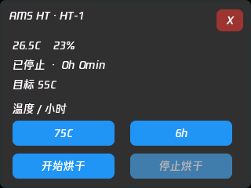
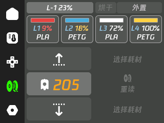
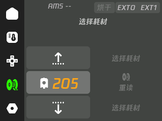

# 新机型与 AMS 支持

xTouch-CN 1.0.0。图片为实体控制屏的 320×240 原始画面。除 P1S 的 LAN / Cloud 对照外，新机型状态及控制回复来自本地 TLS MQTT 虚拟打印机；不代表这些新型号已经完成硬件动作测试。

## 喷头与 H2C 热端仓

点击温度卡片打开数字键盘，左侧切换 T0 / T1 与受支持的仓温。喷头可输入 **0–300°C 的任意整数**；0 表示关闭加热。按绿色确认键后核对目标再执行。

| 喷头控制 | 数字键盘 |
| --- | --- |
|  |  |

数字页的“更多”进入操作菜单，按能力提供设温、切换喷头、指定喷头挤出／回抽 10mm、热端仓和主动仓温。喷头切换和挤出仅在空闲且状态有效时启用；挤出／回抽要求对应喷头至少 170°C。每个操作先确认，执行前再次校验设备与状态。

H2C 的两个加热喷头与热端仓中的可换热端分别管理，不把仓中多个热端当作多个独立加热喷头。

| 输入 217°C | H2C 热端仓 |
| --- | --- |
|  |  |

热端仓入口：**喷头控制 → 操作菜单 → 热端仓 → 确认**。按实际上报列出热端位置、直径和类型，支持重读当前／全部、确认当前／全部、归位、升起 A／B。打印、喷头忙碌、热端仓忙碌或正在读取时禁止动作。尚未提供“一键指定热端并完整交换”的自动流程。

支持主动仓温加热的机型可在同一菜单输入仓温：C13 上限 60°C，其余已识别加热机型上限 65°C。缺少有效目标遥测时禁用，不向 P1S 等无加热能力机型发送该命令。

| 烘干数字编辑 | 耗材页烘干按钮 |
| --- | --- |
|  |  |

## AMS 与烘干

支持烘干时，耗材页的 **重读** 卡片一分为二，右侧 **烘干** 打开当前 AMS 详情；传统 AMS / Lite 保留完整重读卡片。更多单元可滑动，外置区域固定。长按单元名称也可进入详情。

| HT 烘干入口打开的详情 | HT 烘干状态 |
| --- | --- |
|  |  |

AMS 2 Pro：45–65°C；AMS HT：45–85°C；温度支持范围内的整数，1–24 小时。温度与时长使用统一数字页，修改只保留草稿，确认开始后才发送。`dry_time` 以分钟解析，`dry_duration` 以小时设置。打印、准备、暂停时不启动烘干；检查、烘干、冷却阶段可发送停止请求。旋转料盘、自定义冷却温度、电源冲突覆盖和自动烘干尚未开放。

| 缩写 | 含义 |
| --- | --- |
| `1-A` | 第一代 AMS，编号 A |
| `2-B` | AMS 2 Pro，编号 B |
| `HT-3` | AMS HT，编号 3 |
| `L-1` | AMS Lite，编号 1 |

首页与耗材页使用同一规则；只有一个 AMS 时首页省略编号。返回首页时显示第一个单元。

## 槽位、混合与双路外置

按实际存在掩码显示有效槽位，没有 16 槽显示上限。内部有界缓存对应当前协议：4 个四槽单元、8 个 HT，以及一个 Lite Mixed 组；空缓存位置不产生假槽位，也不表示任意硬件组合都能连接。

| Lite Mixed | 双路外置 |
| --- | --- |
|  |  |

- 标准单元 ID 0–3；HT ID 128–135；Lite Mixed 原始 ID 16–31，使用协议的独立存在位和槽位掩码。
- HT 单槽显示，控制恢复实际 ID；Lite Mixed 进料发送原始 AMS ID 与独立 `slot_id`，不把界面索引作为物理编号。
- 双喷头仅在绑定与装载来源明确时开放进退料。T0 外置与 T1 外置分别转换为新协议 ID 255／254；旧设备外置协议保持 254。
- 选择耗材不执行换料；实际装入来源与界面选择分别标记。重读仅用于 AMS RFID，外置不提供该功能。
- 不明确、矛盾、未知的绑定禁用控制。Studio 的共享绑定是 `E` 且需有效供料切换器状态；`F` 不是共享路径。当前未开放共享绑定重分配。

## P1S 的 5°C 仓温

LAN 与 Cloud 使用相同的 MQTT 解析和运行时型号识别。P1S 未启用外接仓温传感器时隐藏 `chamber_temper: 5` 等占位值，不将其作为有效仓温。

## 协议与测试边界

BambuStudio 基准提交：`79df7ae309be398ed30c9f397c13c9911c2edc57`。

| 内容 | 主依据 |
| --- | --- |
| AMS、烘干、Lite Mixed | `DevFilaSystem.cpp` / `DevFilaSystemCtrl.cpp` |
| T0/T1 状态与切换 | `DevExtruderSystem.cpp` / `DevCtrl.cpp` |
| H2C 热端仓 | `DevNozzleRack.cpp` / `DevNozzleSystem.cpp` |
| 进退料、RFID、指定喷头挤出 | `DeviceManager.cpp` |
| 主动仓温 | `DevChamber.cpp` / `DevChamberCtrl.cpp` |

[BambuStudio 源码](https://github.com/bambulab/BambuStudio/tree/79df7ae309be398ed30c9f397c13c9911c2edc57/src/slic3r/GUI)。故障资料统一见 [故障码](ERROR-CODES.md)，仅按 Studio 当前资料维护。

型号识别与五个主页面的模拟测试覆盖 `BL-P001`、`BL-P002`、`C11`、`C12`、`C13`、`N1`、`N2S`、`N6`、`N7`、`N9`、`O1C`、`O1C2`、`O1D`、`O1E`、`O1S`。型号图片与基础连接通过不等同于所有控制均已适配。

MQTT 接收缓冲按需增长，上限 61,439 字节；只提取界面实际需要的字段，帧处理后回收。超大包整包丢弃，后续正常包仍可处理。38KB 帧期间连续创建／销毁控制页 12 次及主页面切换通过，处理后堆约 103–107KiB，未观察到逐次下降；70KB 超限帧后恢复通过。791 项映射与参数边界检查、7,900 项故障格式与分机型动作检查通过。

待对应硬件验证：H2C 热端仓实际运动、双喷头加热与挤出、双路外置换料、HT / Pro 实际烘干。模拟回复只验证解析、命令参数、确认与状态流程，不能证明机械动作成功。

完整操作规则见 [交互说明](INTERACTION.md)。新式风道协议被识别后禁用旧风扇指令，尚未开放该风道的独立控制。
