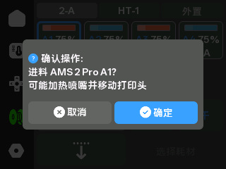
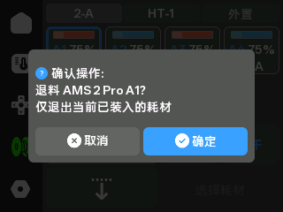
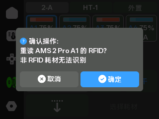

# Printers, AMS and control compatibility

[简体中文](PRINTERS.md) | English | [Documentation](README.en.md)

[Status and filament](#capabilities) · [Nozzles, AMS and drying](#ams) · [Control permissions](#authorization) · [Models and display](#models)

## Status and filament controls

Available functions depend on the printer model, firmware, connected accessories and connection permissions. Both LAN and Bambu account connections display reported printer status.

| Function | Details |
|---|---|
| Printing | Progress, remaining time, layers, pause, resume and cancel |
| Temperatures | Actual and target nozzle/bed temperatures; valid chamber readings |
| Fans and speed | Supported fan percentages and print speed modes |
| AMS | Material, color, valid remaining percentage, humidity and enclosure temperature |
| Filament | Load, unload, RFID refresh and supported AMS drying |
| Motion | Idle homing, stepped movement and extrusion/retraction |

Invalid or missing readings are not shown as zero. Humidity levels and percentages are different readings. Remaining filament is shown only when reported by the printer.

### Filament operation

1. Select an AMS slot or external spool on the filament page. Blue marks your selection; green marks the loaded source. Selecting a slot does not change filament.
2. Choose Load, Unload or Refresh and confirm the source. Select the same slot again to deselect it.
3. Unload applies only to the loaded source. RFID refresh applies only to AMS RFID filament, not external spools or filament without RFID.

Loading may unload the current filament, heat the nozzle and move the print head. Set nozzle temperature first when no valid material temperature is available. Related manual controls are unavailable while printing, paused, preparing, or while the AMS is busy or reading a tag.

Swipe to select additional AMS units; the external spool entry stays on the right. Hold an AMS name to view details.

| Load confirmation | Unload confirmation | RFID confirmation |
|---|---|---|
|  |  |  |

## Nozzles, AMS and drying

### Nozzles and chamber temperature

Tap a temperature card to open the keypad, select the parameter on the left and confirm with the green key. Nozzle targets accept integers from 0–300°C; zero turns heating off.

The More menu offers supported T0/T1 selection, indexed 10 mm extrusion/retraction, nozzle rack and chamber heating. Extrusion/retraction requires the selected nozzle to be at least 170°C. Motion controls require an idle printer and a valid state.

The H2C rack page shows positions, diameters and types, with refresh, acknowledgement, home and raise A/B actions. A complete automatic hotend exchange is not provided.

Active chamber heating requires a supported heater and valid target telemetry: up to 60°C for X1E and 65°C for other supported heated models. P1S has no active chamber heater; its invalid placeholder readings are hidden.

### AMS and drying

Supported AMS units show a Drying entry on the filament page. Set temperature and duration, then confirm Start drying.

| Accessory | Drying temperature | Duration |
|---|---|---|
| AMS 2 Pro | 45–65°C | 1–24 hours |
| AMS HT | 45–85°C | 1–24 hours |
| AMS / AMS Lite | No drying control | — |

Drying cannot start while printing, preparing or paused. Stop is available during checking, drying and cooling. Tray rotation, custom cooling temperatures, automatic drying and shared feed-route reassignment are not provided.

Dual nozzles and dual external spools follow the reported source bindings. Ambiguous sources disable related controls. New airflow systems, new bed controls and other unsupported capabilities have no independent controls. Full physical compatibility for H2C rack actions, dual nozzles, dual external spools and Pro/HT drying is not yet confirmed.

## LAN and cloud authorization

**Some controls require LAN mode and developer mode.**

A Bambu account Access Token connects the account, retrieves printers and subscribes to status. It does not guarantee permission for every control command. This version does not support the official signed cloud-command channel.

For `84033543` or authorization HMS `0500-0500-0001-0007`, use the printer's LAN profile and check its LAN/developer-mode settings. Replacing the Token does not remove command authorization restrictions.

Light, temperature, fan, motion, pause/resume/cancel and AMS permissions can vary by model and firmware. Follow printer feedback and actual state. An accepted request does not mean a mechanical action has finished.

[Notifications and faults](USER-GUIDE.en.md#notifications) · [Online code lookup](https://tbc0309.github.io/xTouch-CN/errors.html)

## Models and display

The home page uses the model reported by the printer. Until a valid model is received, or for an unknown model, it shows the xTouch logo. Artwork covers X1 / X1 Carbon / X1E, P1P / P1S, A1 / A1 mini, P2S, X2D, A2L, H2C, H2D, H2D Pro and H2S. Artwork recognition does not imply complete control compatibility.

Printer artwork appears while a job thumbnail is unavailable; ESP32-2432S028R always uses printer artwork. See [Camera support](../boards/CAMERA.md) for camera and thumbnail requirements.

Tap the home printer card to cycle between up to two printers; with three or more it opens the printer picker. Holding always opens the picker. Long names scroll. Switching clears the previous printer's filament selection and fault notifications.

Remaining filament of 10% or less is red; 11–20% is yellow. Unknown remaining amounts have no percentage.
