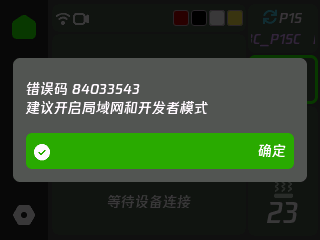
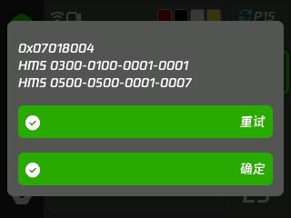

# 提示与故障弹窗

界面显示状态、错误码和操作确认。控制屏及后台均按当前语言显示，未知语言回退英文。

## 公用提示

| 提示 | 出现条件 | 行为与复用位置 |
| --- | --- | --- |
| 错误码 `84033543`；建议使用：开启局域网和开发者模式 | 打印机拒绝命令验证 | 适用于温度、运动和耗材等控制。需要改用 LAN 设备连接，不能保证只改打印机开关就能使 Cloud 命令可用 |
| 控制命令被拒绝；错误码 `n` | 其它命令拒绝或本地发送失败 | 保留返回代码；不一律推断为账号过期或开发者模式问题 |
| 设备忙或状态已变更 | 打开确认后切换设备、超时、能力或忙碌状态改变 | 关闭过时的操作确认，不发送控制命令 |
| 请求已发送，等待设备响应 | 耗材、喷头、烘干控制已发布 | 短提示，不能视为成功 |
| 设备已接受请求 | 对应请求收到成功回复 | 短提示，不能视为加热、进退料或机械动作已完成 |
| 等待超时，请检查设备状态 | 对应请求未及时收到回复 | 常驻，点确认关闭；不擅自重发动作 |
| 正在切换到设备名称 | 切换设备 | 在连接等待位置短暂显示；不是独立弹窗 |

命令回复仅匹配本设备发出的请求序号、命令和设备，不将同主题里其它客户端的回复作为自己的结果。`print` 与 `system` 控制统一处理错误；AMS、喷头和烘干仍匹配各自待应答请求。

## 操作确认

| 操作 | 必要信息 | 确认后 |
| --- | --- | --- |
| 暂停、取消打印 | 即将执行的操作 | 只执行对应操作；取消不与暂停共用文案 |
| 归位 | 打印头将移动 | 再检查设备与运动状态 |
| 设温、运动与喷嘴仓操作 | 参数、目标喷头或槽位 | 复用数字键盘；确认当前参数，不隐式提交其它参数 |
| 进料、退料 | 当前耗材槽位；可能加热、运动 | 重新验证选中耗材和设备；不能将两个动作的确认合并 |
| RFID 重读 | 耗材槽位、需要 RFID 耗材 | 只请求重读，不自动改写耗材资料 |
| 开始／停止烘干 | AMS、温度和时间或停止动作 | 只控制选中的 AMS |
| 重启、恢复出厂 | 明确的动作名称 | 普通重启不等同于清空配置 |
| 翻转屏幕 | 重启后应用 | 确认后保存重启 |

操作确认有取消与确认；普通状态／失败提示只提供确认。确认绑定打开时的设备，30 秒后失效。新故障出现时取消旧操作确认，防止关闭故障提示后误执行过时动作。

## HMS、打印错误码与命令错误码

| 来源 | 含义 | 例子与显示方式 |
| --- | --- | --- |
| MQTT `print.hms` | Health Management System 健康监测报告，包含警告及故障；不保证阻止打印 | `attr` 与 `code` 两个原始 32 位字段合成 `HMS 0500-0500-0001-0007` |
| MQTT `print.print_error` | 当前打印／设备错误，可能附带厂商定义的重试、完成操作 | `0x07018004` |
| 控制回复 `err_code` | 某次命令的结果；不等于持续存在的 HMS 或当前打印故障 | `84033543`；使用普通结果提示，不自动添加到设备故障列表 |

三者没有“先打印错误、然后才能出现 HMS”的前置关系。它们可单独存在、同帧到达或先后到达，也不一定一一对应。HMS 不能一律理解为严重错误，确认弹窗也不表示故障已经修复。

### 同一故障弹窗

以下为模拟上报后的实机显示示例，不代表截图中的打印机正在发生这些故障。

- 同一帧先更新两类状态，再刷新一次弹窗；打印错误在前，当前 HMS 按代码排序列在后面。
- 先后到达时更新同一个弹窗，不互相覆盖，也不创建第二个故障弹窗。
- 列表过长时纵向滚动，列表高度随按钮数量调整，底部按钮固定可见。最多保留按代码排序的前 50 条 HMS，超过时显示 `...`，不为异常大报文无限分配内存。列表逐行构造，只用 32 字节临时格式缓冲；关闭后释放列表文字。
- 相同代码去重，HMS 顺序改变不算新故障。确认后相同报告不再次弹出；新增代码或不同的打印错误才再次提醒。
- 缺失的增量字段保留上次状态；`print_error: 0` 清除打印错误，`hms: []` 清除 HMS。格式错误的 HMS 数组不当成清空。全部清除时自动关闭故障弹窗。
- HMS 与打印错误保存为不同类型，不能靠数值大小判断；前半部分为零的 HMS 仍按 HMS 显示。
- 重试／完成按钮只根据当前打印错误和机型规则显示；不会给 HMS 批量执行恢复。确认 HMS 仅本地关闭；有打印错误时沿用原有的 `clean_print_error` 确认流程。
- 执行按钮前重新检查设备、在线状态、代码及状态版本；切换设备清空旧故障状态，避免操作到新设备。

查看含义使用[故障码查询](https://tbc0309.github.io/xtouch-CN/errors.html)或[代码文档](ERROR-CODES.md)，固件不内置完整故障说明。

## 网页提示

管理页提示显示在“保存并重启”左侧；登录与配网页的提示显示在卡片下方居中。

| 原因 | 提示原则 |
| --- | --- |
| 未登录、会话失效 | 要求重新登录管理后台，不显示拓竹账号错误 |
| Cloudflare 拦截 | 显示 HTTP 状态，建议从官方登录取得 Token 后导入；不将账号判为密码错误 |
| 密码／验证码失败、Token 失效 | 使用对应认证结果，不和网络超时共用“登录失败” |
| 网络超时、服务器错误 | 保留网络／HTTP 类别，不清除之前保存的有效账号资料 |
| 配置校验失败 | 指明当前字段或原因；复用既有校验文案 |
| 已修改、待重启 | 统一待保存状态和“保存并重启”按钮，不为每项设置另造重启提醒 |
| 固件升级、导入备份、重置 | 独立结果及确认，不与普通保存成功混用 |

字典来源：基础界面 `src/ui/i18n/*.h`、扩展界面 `resources/ui-locales.json`、网页 `resources/portal-locales.json`。新增提示前先查同类原因和动作；只有信息或安全后果不同才新增条目。

协议参考：[BambuStudio](https://github.com/bambulab/BambuStudio/blob/master/src/slic3r/GUI/DeviceManager.cpp)、[ha-bambulab 状态模型](https://github.com/greghesp/ha-bambulab/blob/main/custom_components/bambu_lab/pybambu/models.py)。
